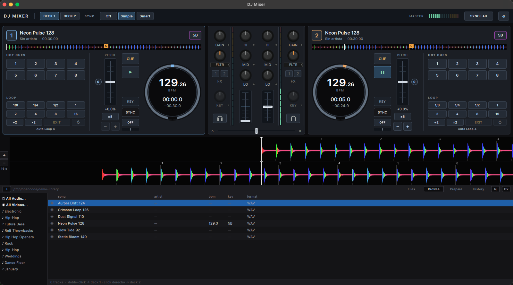

# DJMixer

**Software de DJ nativo en la liga de Serato y Traktor. La versión Lite es gratis
para todo el mundo, para siempre.**

Este repositorio es el **sitio público** del proyecto: la página de financiación,
las capturas de la app, las notas de desarrollo y las especificaciones técnicas.
El código fuente está en un repositorio privado hasta la primera release; el
source completo se publica con el primer binario, porque es lo que exige la
licencia GPL-2.0-or-later.

- 🌐 **Sitio:** https://mcontreraz.github.io/djmixer
- 💛 **Apoyar el proyecto:** [`FUNDING.md`](FUNDING.md) · USDC en Stellar
- 📜 **El compromiso (canónico):** [`docs/promise.md`](docs/promise.md)
- 📓 **Notas de desarrollo:** [`docs/devlog.md`](docs/devlog.md)
- 📐 **Especificaciones:** [`specs/INDEX.md`](specs/INDEX.md)

## La promesa

**La versión Lite se lanza gratis para todo el mundo y lo seguirá siendo.** Sin
precio, sin cuota, sin suscripción, sin trial que expire. No es una promoción de
lanzamiento: es la razón de existir del proyecto — que cualquier DJ que quiera
ser DJ pueda empezar sin pagar mensualidades ni comprar software caro.

**Existirá una versión Pro de pago**, para lo que un DJ necesita cuando crece
(stems, grabación, DVS, análisis armónico avanzado) y nunca para lo esencial de
mezclar.

## Qué es

Aplicación de DJ **nativa** (C++17 + Qt 6 / QML), no un wrapper web:

| Área | Estado | Detalle |
|---|---|---|
| Motor de audio | Listo | Hilo de callback sin locks y sin tocar la UI. El camino de loop no asigna memoria; el path general de playback reasigna el buffer cuando cambia el número de muestras. Cache de PCM, seqlock, colas SPSC. 48 kHz. |
| Decks | Listo | 2 decks + crossfader, cue, seek, PFL, 8 hot cues por deck con sidecar persistente |
| Tempo | Listo | Pitch/tempo (±8/16/32 %) con pitch-bend continuo, scratch estilo vinilo |
| Key lock | Listo | Motor Rubber Band (GPL-2.0-or-later) en tiempo real, con crossfade de entrada y salida para que la transición no haga clic |
| Tonalidad | Listo | Detección con nomenclatura Camelot, cacheada por pista |
| Beats | **En validación** | Detección de BPM y downbeat, beatgrid, y lectura del blob BeatGrid de Serato que el tema ya trae en su propio tag (MP3 GEOB / M4A). El detector automático se sigue validando contra pistas reales y el repo lo dice en todas partes |
| Loops | Listo | Auto-loops 1/8…16 beats sobre el beatgrid, resize diferido: sin click ni hueco |
| Sync | Listo | Corrección de fase, compensando la latencia audible del key lock |
| Mezcla | Listo | EQ de 3 bandas, filtro, FX por canal, VU master |
| Waveform | Listo | RGB con detalle a 200 buckets/s, overview en color, zoom 2–64 s |
| Scratch | Listo | Continuo, sin granulación audible |
| MIDI | Listo | Mapeo completo, sensibilidad de jog, pitch-bend |
| Decodificación | Listo | MP3, FLAC, AAC, MP4/M4A, Opus (AV1+Opus por stream-copy) |

## El equipo

Un humano (ingeniero de software chileno, amante de la música) y cuatro agentes de
IA orquestados con Paperclip: **CTO, Coder, QA y Growth**.

## Apoyar

El cuello de botella real es la **capacidad de modelos de IA** que consume el
equipo de agentes. Cada decisión de motor, cada estudio de referencia y cada
iteración de tests cuesta tokens.

- **USDC (Stellar / Soroban):** `GATED25F24BNVPQKSZCTRSBSKGHPZVDQUCM6JXAAQHDRZDVZEWDC7NO7`
  (cuenta multisig 2-de-6; recibir no requiere firma)
- Niveles: USDC 20 · 100 · 500 · **2.000** (objetivo del primer tramo)
- Qué compra: tokens del equipo, MIDI controller para validar con hardware real,
  y la cuenta de Apple Developer (99 USD/año) para que la descarga salga firmada

**Es una donación, no una inversión**: no hay token, ni participación, ni promesa
de retorno. Puede ser ingreso imponible para quien dona (en Chile, SII).

Detalle completo y verificación de la dirección: [`FUNDING.md`](FUNDING.md).

## Licencia

GPL-2.0-or-later. El código fuente completo se publica junto con el primer
binario distribuido, como exige la licencia.

## Ingeniería inversa: qué se publica y qué no

El proyecto estudia el **comportamiento observable** de los productos de
referencia y documenta los hallazgos con cita de la documentación oficial. Al
repositorio público sale ese análisis de comportamiento; la evidencia cruda
(decompilados, volcados de strings, esquemas del fabricante, proyectos Ghidra)
**no se publica** y se queda en la máquina de desarrollo. Nunca se copió código
ajeno.

## El álbum va con la Lite

El humano de este proyecto es un DJ, y su primer lanzamiento se incluye
completo en la versión Lite — gratis, para todo el mundo, para siempre.

**Relaunch — McBaez (McDiscJockey)** · deep garage / 2-step '90s

- ▶ https://www.youtube.com/watch?v=m7lIbyha2kQ
- https://open.spotify.com/track/2lzdEocFpWso7knzCtL46g
- Canal: https://www.youtube.com/@McDiscJockey

El proyecto de software y el proyecto musical son el mismo: las funciones
deterministas con las que un DJ juzga el software de verdad —beat matching que
cae en la grilla, scratch sin granulación audible, trim y nivel que aterrizan
donde la mano espera— son las que se están entrenando. Por eso el álbum va
dentro: no es un chamariz, es la razón de que exista la herramienta.

## Páginas de funding por idioma

- Español: https://mcontreraz.github.io/djmixer/funding.html
- English: https://mcontreraz.github.io/djmixer/funding.en.html
- Português: https://mcontreraz.github.io/djmixer/funding.pt.html
